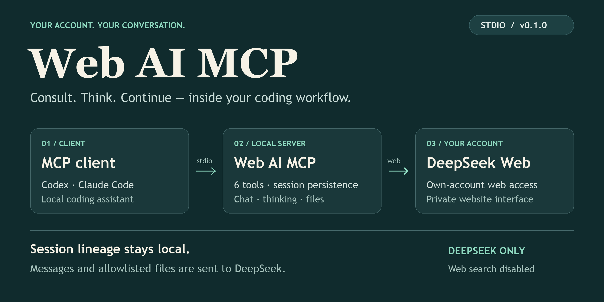
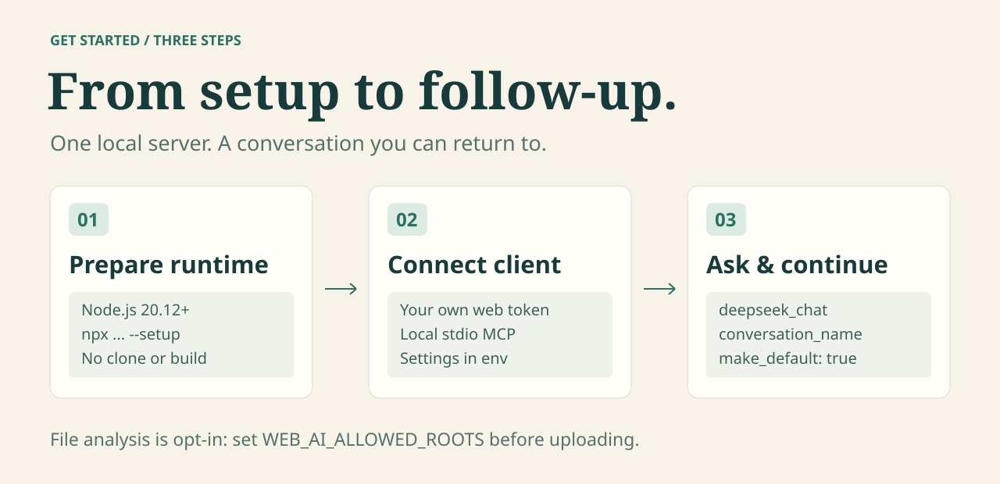

# Web AI MCP

[](https://github.com/983033995/web-ai-mcp/actions/workflows/ci.yml)



通过 MCP，让本机 AI 编程助手调用**你自己的 DeepSeek、豆包网页账号**，进行聊天、深度思考、文件分析和多轮讨论；豆包另支持图片、视频生成。

当前源码另加入 **Gemini 网页聊天、图片和视频生成（实验性）**，支持命名会话、后台任务、只读媒体查询/下载，以及按配置顺序选择本人账号和独立额度冷却。Gemini 尚未包含在已发布的 `web-ai-mcp@0.4.0` 中，请按[源码接入说明](#gemini-接入源码实验功能)使用；能力与实测边界见[验证记录](docs/GEMINI_VALIDATION.md)。

适用于咨询代码、比较方案、持续讨论项目和生成图片/视频的场景。程序通过 npm/npx 安装，作为本机 **stdio MCP server** 运行。v0.2.0 加入实验性豆包网页版接入；v0.1.2 及更早版本只支持 DeepSeek。豆包已完成本人账号的代表性实测，仍受网站风控、额度和私有接口变化影响。验证边界见[风控记录](docs/DOUBAO_RISK_INVESTIGATION.md)和[生成验证](docs/DOUBAO_MEDIA_VALIDATION.md)。

> **本文对应 v0.4.0（`package.json` / 当前 npm 发行）。** v0.3.0 起已含长聊天后台任务与首次使用指引；Gemini 网页能力在当前源码中为实验性，**尚未**打进已发布的 `web-ai-mcp@0.4.0`，请按下文源码接入。npm 实际版本以 registry 为准。 项目自身代码采用 MIT，通过 GitHub Release / Actions 验证并发布（OIDC，无长期 npm token）。npm 地址用于安装程序，不是远程 MCP 服务地址；使用者无需部署服务器。已有网站验证见[验证记录](docs/LOCAL_VALIDATION.md)，历史验证不保证后续私有接口稳定。DeepSeek 所需上游 WASM 不随 npm 包分发，其再分发许可仍未确认。

## 目录

- [功能与边界](#功能与边界)
- [快速开始](#快速开始)
- [接入 MCP 客户端](#接入-mcp-客户端)
- [工具与调用示例](#工具与调用示例)
- [环境变量](#环境变量)
- [会话持久化与恢复](#会话持久化与恢复)
- [常见问题](#常见问题)
- [开发与验证](#开发与验证)
- [隐私、安全与许可](#隐私安全与许可)
- [项目结构与文档](#项目结构与文档)

## 功能与边界

| 能力 | 当前状态 |
| --- | --- |
| DeepSeek 网页聊天 | 已实现，使用本人网站登录凭据 |
| 深度思考 | 已实现，可选择显示网站返回的思考文本 |
| 多轮续聊 | 已实现，本地 ID、命名会话、项目默认会话及重启恢复 |
| 文件分析 | 已实现，仅允许上传显式授权目录内的文件 |
| 会话管理 | 已实现，列出或关闭本地会话映射 |
| 网站搜索 | 未启用，`search_enabled` 固定为 `false` |
| 豆包（v0.2.0 起） | 实验性快速/专家聊天、可见思考、TXT 分析、可选模型/参数的图片与视频生成、参考图及同会话续聊 |
| Gemini（当前源码） | 实验性模型选择、三档思考等级、文件分析、图片/视频生成、原生比例、参考素材、后台任务和多账号额度冷却；参考视频生成仍为实验选项 |
| 其他网站 | 未实现，不可调用 |
| HTTP / 远程多用户 MCP | 未实现，仅支持本地 stdio |

本项目不是 DeepSeek 官方 API 客户端、OpenAI 兼容代理或 CLIProxyAPI 插件。它提供咨询工具，不会自行修改代码或执行 DeepSeek 返回的建议，也不提供公共免费 API 服务。

## 快速开始



### 1. 准备运行环境

需要 Node.js **20.12 或以上**、npm，以及访问 npm、GitHub 原始文件和 DeepSeek 网站的网络，建议使用受支持的 Node.js LTS。npm 包已经编译，不需要 Git、克隆项目或手动构建。

先准备一次 PoW WASM（不需要网站 token）：

```bash
npx -y web-ai-mcp@0.4.0 --setup
```

首次启动也会自动准备；显式执行 `--setup` 可避免客户端下载时间叠加 MCP 启动超时。WASM 从固定上游提交下载到本机缓存并校验 SHA-256，不写入 npm 安装目录，也不随包分发。后续版本更新请明确修改配置中的版本号。

npx 会自动安装已编译的包，不需要克隆项目或运行构建命令。npm 安装不执行下载脚本；仅在 `--setup` 或服务初始化缺少本机 WASM 时下载。可通过 `WEB_AI_WASM_PATH` 指定同哈希的本机文件，来源说明见 [THIRD_PARTY_NOTICES.md](THIRD_PARTY_NOTICES.md)。

### 2. 获取本人网站凭据

1. 在浏览器登录 [DeepSeek 网站](https://chat.deepseek.com)，确认能够正常聊天。
2. 打开开发者工具 → **Application（应用）→ Local Storage（本地存储）→ `https://chat.deepseek.com`**。
3. 找到 `userToken`，仅在本机复制其 token 值。若显示为 JSON，取其中实际 token 字符串；不要复制整个对象、引号或 `Bearer ` 前缀。

这是网站登录凭据，**不是** DeepSeek 开放平台 API key。网站可能调整存储形式；若找不到该字段，不要把整份浏览器存储、Cookie 或请求头发到 Issue 中。

### 3. 直接在 MCP 配置中填写参数（推荐）

**不需要创建 `.env` 文件。** 在支持 `mcpServers` 的客户端配置中，添加 `web-ai-mcp`，把网站 token 放在 `env` 中即可。最小可用配置：

```json
{
  "mcpServers": {
    "web-ai-mcp": {
      "type": "stdio",
      "command": "npx",
      "args": ["-y", "web-ai-mcp@0.4.0"],
      "env": {
        "DEEPSEEK_USER_TOKEN": "YOUR_OWN_DEEPSEEK_WEB_TOKEN"
      }
    }
  }
}
```

将 token 占位值替换为本人网站 token。如果已有 `mcpServers`，只合并其中的 `web-ai-mcp` 项，不覆盖其他服务。Codex 使用 TOML，完整示例见下一节。

| 配置位置 | 填什么 | 例子 |
| --- | --- | --- |
| `command` / `args` | 启动服务的命令、包名和 CLI 选项 | `npx`、`-y`、`web-ai-mcp@0.4.0` |
| `env` | 服务启动时的配置，值都用字符串 | `DEEPSEEK_USER_TOKEN`、`WEB_AI_PROJECT_ROOT` |
| 每次工具调用的 JSON | 本轮问题、会话选择或文件列表 | `message`、`conversation_name`、`file_paths` |

不要把 token、上传目录等自定义键直接放在 `web-ai-mcp` 顶层，也不用把 token 放到 `args` 中。`env` 由客户端传给服务；豆包配置和获取步骤见[豆包接入](#豆包接入配置参数与获取方式)。

真实 token 只能保存在本机私有配置中，不要提交含 token 的 `.mcp.json` 或 `.codex/config.toml`。要共享项目配置时，使用下文的环境变量转发或可选 `.env` 方式。

### 4. 连接客户端并开始使用

按下一节配置一个客户端，重新加载 MCP 连接，然后尝试：

> 调用 `webai_providers` 查看可用服务，再调用 `deepseek_chat`，询问“请用一句话介绍你能帮我做什么”。

仅配置 DeepSeek 时应发现 9 个工具，仅豆包为 13 个，两者同时配置为 18 个。当前源码仅配置 Gemini 为 14 个，三者同时配置为 28 个。工具发现说明本地连接成功；收到实际答案才说明当前账号的网站请求成功。

## 接入 MCP 客户端

选择你使用的客户端示例即可，不需要同时配置多种方式。客户端会启动和管理服务进程，无需另外运行 `npm start`；修改 `env` 后重启 MCP 连接。

### JSON 配置：Claude Code 与同类客户端

只聊天时，使用上面的最小配置。需要项目续聊、文件分析或更长超时时，在**同一个 `env` 对象**中加入对应变量。常用完整配置如下：

```json
{
  "mcpServers": {
    "web-ai-mcp": {
      "type": "stdio",
      "command": "npx",
      "args": ["-y", "web-ai-mcp@0.4.0"],
      "env": {
        "DEEPSEEK_USER_TOKEN": "YOUR_OWN_DEEPSEEK_WEB_TOKEN",
        "WEB_AI_PROJECT_ROOT": "/absolute/path/to/your-project",
        "WEB_AI_ALLOWED_ROOTS": "/absolute/path/to/your-project/docs",
        "DEEPSEEK_TIMEOUT": "120000",
        "WEB_AI_SESSION_TTL_MINUTES": "0"
      }
    }
  }
}
```

| 参数 | 必填吗 | 怎样填写 |
| --- | --- | --- |
| `DEEPSEEK_USER_TOKEN` | 必填 | 本人网站 token，不带 `Bearer ` 前缀 |
| `WEB_AI_PROJECT_ROOT` | 推荐 | 正在讨论的项目绝对路径；用于固定会话存储位置，不是 npm 包安装路径 |
| `WEB_AI_ALLOWED_ROOTS` | 文件分析时才需要 | 允许上传的目录；只聊天可删除这一行或设为 `""` |
| `DEEPSEEK_TIMEOUT` | 可选 | 整轮网站操作超时，毫秒；默认 `"60000"`，示例为 120 秒 |
| `WEB_AI_SESSION_TTL_MINUTES` | 可选 | 默认 `"0"`，不设本地会话过期；正数表示闲置分钟数 |

目录与 token 占位值都需要替换。macOS / Linux 多个上传目录用 `:` 分隔，Windows 用 `;`；Windows 路径推荐 `C:/Projects/demo/docs`，也可以把反斜杠写成 `\\`。服务不会自动上传项目目录，仅在调用文件工具并选中文件时上传。

把 `.web-ai-mcp/` 加入所讨论项目的 `.gitignore`，不要共享不同账号的会话存储。客户端如果有独立的工具超时选项，应大于 `DEEPSEEK_TIMEOUT`；这项属于客户端设置，不能代替服务的超时变量。

Claude Code 的项目级文件是 `.mcp.json`；含真实 token 的配置不要提交。若需要共享这个文件，可将 token 值写成 `"${DEEPSEEK_USER_TOKEN}"`，由 Claude Code 的运行环境注入；变量替换是否受支持以各客户端文档为准，不要把这种写法原样套用到所有客户端。首次使用按提示批准项目 MCP，参考 [Claude Code MCP 文档](https://code.claude.com/docs/en/mcp)。

### Codex：TOML 配置

在本机 `~/.codex/config.toml` 中添加，保留已有内容：

```toml
[mcp_servers.web-ai-mcp]
command = "npx"
args = ["-y", "web-ai-mcp@0.4.0"]
startup_timeout_sec = 60
tool_timeout_sec = 180

[mcp_servers.web-ai-mcp.env]
DEEPSEEK_USER_TOKEN = "YOUR_OWN_DEEPSEEK_WEB_TOKEN"
WEB_AI_PROJECT_ROOT = "/absolute/path/to/your-project"
WEB_AI_ALLOWED_ROOTS = "/absolute/path/to/your-project/docs"
DEEPSEEK_TIMEOUT = "120000"
WEB_AI_SESSION_TTL_MINUTES = "0"
```

只聊天时可删除 `WEB_AI_ALLOWED_ROOTS`。`startup_timeout_sec` 和 `tool_timeout_sec` 是 Codex 的超时选项，单位秒；`DEEPSEEK_TIMEOUT` 是本服务的变量，单位毫秒。

如果不想把 token 写入配置文件，可在上面的主表增加 `env_vars = ["DEEPSEEK_USER_TOKEN"]`，并删除 `[mcp_servers.web-ai-mcp.env]` 中的 token 行；这样 Codex 转发自己运行环境中的变量。从桌面启动的 Codex 未必继承终端里的 `export`。参考 [Codex 官方 MCP 文档](https://developers.openai.com/codex/mcp)。

### 可选：使用 `.env` 文件

只有你希望把参数集中保存在独立本机文件中时才需要此方式。用编辑器创建 `/absolute/path/to/web-ai.env`：

```dotenv
DEEPSEEK_USER_TOKEN=YOUR_OWN_DEEPSEEK_WEB_TOKEN
WEB_AI_PROJECT_ROOT=/absolute/path/to/your-project
```

将 JSON 配置中的启动参数改为下面的值，并删除重复的 `env` 参数：

```json
{
  "args": [
    "-y", "web-ai-mcp@0.4.0",
    "--env-file", "/absolute/path/to/web-ai.env"
  ]
}
```

这段仅用于替换已有服务的 `args` 字段，不是完整客户端配置。其他可选变量仍可放进文件中。服务不会自动查找 `.env`；只有传入 `--env-file` 才加载。若同时使用 `env` 和文件，同名参数以进程环境中的值为准，见 [Node.js 加载规则](https://nodejs.org/api/cli.html#--env-filefile)。

### 其他客户端与启动问题

使用相同 npx 启动参数和 `env`；配置文件位置、外层字段及启用方式以客户端文档为准。这是本机 stdio 配置，不是 HTTP MCP 地址。桌面客户端找不到 `npx` 时，把 `command` 换成本机 npx 可执行文件路径；某些 Windows 客户端需要填写 `npx.cmd`。

### 默认模型与思考配置（当前源码）

在 MCP 服务配置的 `env` 或显式加载的 `--env-file` 中设置下列可选项。服务器启动时读取并校验，修改后重连 MCP；不设置或留空保持内置行为。已启用 Provider 的未知豆包模型、非法模式或思考等级会使 MCP 启动失败，不静默降级。Gemini 模型名称在实际调用时继续按所选账号的 `gemini_models` 列表校验，不会为了配置检查发送聊天或生成。

| 环境参数 | 可用值 / 含义 | 未配置时 |
| --- | --- | --- |
| `DEEPSEEK_DEFAULT_THINKING` | `true` / `false`；聊天与文件分析默认思考开关 | `false` |
| `DOUBAO_DEFAULT_MODE` | `quick` / `expert`；聊天与 TXT 分析默认模式 | `quick` |
| `DOUBAO_DEFAULT_IMAGE_MODEL` | `Seedream 5.0 Flash`、`Seedream 5.0 Pro`、`Seedream 4.5`、`Seedream 4.0` | `Seedream 5.0 Flash` |
| `DOUBAO_DEFAULT_VIDEO_MODEL` | `Seedance 2.0 Fast`、`Seedance 2.5`、`Seedance 2.0`、`Seedance 2.0 Mini` | `Seedance 2.0 Fast` |
| `GEMINI_DEFAULT_MODEL` | `gemini_models` 返回的准确模型名称，作为通用模型默认值 | 不指定具体版本，使用网页默认路由 |
| `GEMINI_DEFAULT_IMAGE_MODEL` | 生图专用默认模型，优先于通用默认模型 | 回退到 `GEMINI_DEFAULT_MODEL` |
| `GEMINI_DEFAULT_VIDEO_MODEL` | 视频专用默认模型，优先于通用默认模型 | 回退到 `GEMINI_DEFAULT_MODEL` |
| `GEMINI_DEFAULT_THINKING_LEVEL` | `low` / `medium` / `high`；聊天、文件和媒体工具默认等级 | `low` |

例如，在现有 MCP 的 `env` 中合并以下字段，保留已有启动命令和账号配置：

```json
{
  "DEEPSEEK_DEFAULT_THINKING": "true",
  "DOUBAO_DEFAULT_MODE": "expert",
  "DOUBAO_DEFAULT_IMAGE_MODEL": "Seedream 5.0 Pro",
  "DOUBAO_DEFAULT_VIDEO_MODEL": "Seedance 2.5",
  "GEMINI_DEFAULT_THINKING_LEVEL": "high"
}
```

每次调用显式传入的 `model`、`mode`、`thinking` 或 `thinking_level` 优先于环境默认值。例如上面设置豆包 `expert` 后，`doubao_chat` 仍可用 `"mode":"quick"` 或 `"thinking":false` 单次关闭。`deepseek_reasoner` 和 `doubao_reasoner` 始终开启对应思考模式，不受默认关闭配置影响；`show_reasoning` 仅控制返回文本的显示，不改变思考强度。DeepSeek 未实现具体模型版本选择，豆包聊天也没有任意模型名或三档思考强度配置。

Gemini 的选择优先级是 **本次显式参数 → 会话已保存的选择 → 本次能力专用默认模型 → 通用默认模型 → 网页默认路由**。思考等级同理，最后回退到 Low。重启或修改默认值不会替换已有会话保存的模型/等级；不兼容、未知或不确定的会话仍按原规则拒绝，不新建会话绕过。生图/视频的模型与思考组合能否完成媒体，以网站返回的实际资源为准。

这些配置只作用于已启用的 Provider，不会自动启用缺少账号凭据的网站；错误默认值不会打印配置内容或凭据。默认值不写入全局网页偏好，也不改变其他客户端的设置。

## 工具与调用示例

### 首次使用与长时间思考（v0.3.0 起）

先调用 `webai_usage`，了解参数、会话生命周期和错误恢复。服务也通过 MCP 初始化 `instructions` 提供规则，但不同客户端不一定将它传给模型；聊天工具描述会提示读取指南。可复制[使用 Skill](docs/CLIENT_USAGE_SKILL.md)到客户端 skill 目录。

四个聊天/reasoner 工具支持 `background: true`。长问题、专家思考推荐此模式：提交快速返回任务 ID，之后只读查询，不让网页思考占满一次客户端调用。以下以 `deepseek_reasoner` 为例，`request_id` 换成新 UUID：

```json
{
  "message": "请检查方案前提与边界风险。",
  "conversation_name": "architecture-review",
  "background": true,
  "request_id": "78a1f8cd-7e19-4dac-8ccf-b951359542c1"
}
```

按返回的 `poll_after_seconds`（默认10秒）调用 `webai_job_status`：`{"job_id":"实际返回的任务 ID"}`。查询不会重复发送消息；完成后返回原始答案与 `session_key`。不要把 job_id 当会话 key。同一工具、相同参数与相同 request_id 在当前进程内只执行一次；不能用新 ID 自动重放不确定请求。

| 状态/工具 | 处理方式 |
| --- | --- |
| `running` | 按建议间隔查询，不再次提交聊天 |
| `completed` | 读取原始答案和本地会话 key，再续聊 |
| `failed` / `cancelled` | 阅读原始错误与 `next_action`，不自动重放网站写入 |
| `webai_job_cancel` | 显式传 job_id 取消本机等待；不能撤回网站已受理的消息 |
| 未知/过期 job | 停止重放，检查对应 sessions_list 与官网；本地列表本身不能证明网站是否受理 |

任务与结果只存当前 MCP 进程内存，完成后可查询30分钟，最多保留32个结果；一个进程同时只运行一个后台任务。作业额外截止为12分钟，网站超时仍可提前取消。读取结果前不要断开或重启 MCP；进程退出后不恢复或重试任务，残留 pending 会话继续受失效保护。幂等 ID 的摘要在当前进程保留，最多1024个，达到上限拒绝新提交并要求取完结果后显式重启。

长聊天建议 `DEEPSEEK_TIMEOUT=600000`、`DOUBAO_TIMEOUT=600000`，客户端支持时将工具超时设为大于网站超时，例如660秒。Qoder桌面1.1.69调用桥实测仍有约60秒控制请求限制，单改网站或服务项 `timeout` 不能解除外层上限，应使用后台模式。同步聊天可发送进度通知，但不能保证客户端延长等待。文件分析与媒体生成暂未加入后台选项，异步视频继续用 `doubao_media_status`。

每轮都必须有 message，名称与 ID 只能选一类，布尔值使用 true/false。关闭后的 key 作废；网站会话创建失败、超时、验证码、限流与额度不足不应触发自动重发或换模式。错误附带 `automatic_retry=false` 和恢复步骤。验证与边界见[长任务记录](docs/LONG_TASK_VALIDATION.md)。

以下 JSON 是 **MCP 工具参数**，不是终端命令或 HTTP 请求。可以让 AI 助手调用对应工具，也可以通过 MCP Inspector 手动传入。

| 工具 | 作用 | 必填参数 |
| --- | --- | --- |
| `deepseek_chat` | 普通聊天，可开启思考并续聊 | `message` |
| `deepseek_reasoner` | 始终启用网站思考模式，可续聊 | `message` |
| `deepseek_analyze_files` | 上传并分析允许目录内的本地文件 | `file_paths` |
| `deepseek_sessions_list` | 列出未过期的本地会话 ID、名称和状态 | 无，传 `{}` |
| `deepseek_session_close` | 删除本地映射；不删除网站历史 | `conversation_id` 或 `session_key` |
| `webai_providers` | 查看已实现与预留的 provider | 无，传 `{}` |

### 普通聊天与项目讨论

调用 `deepseek_chat`，创建命名会话并设为项目默认：

```json
{
  "message": "请比较进程内缓存和 Redis 的取舍。",
  "conversation_name": "architecture-review",
  "make_default": true
}
```

之后不传会话选择参数，即继续默认会话：

```json
{
  "message": "如果只有单实例部署，你会怎样调整建议？"
}
```

若希望创建独立讨论，传入一个**从未使用过的** `conversation_name`。已有名称会续聊；没有选择参数且没有项目默认会话时，每次调用会创建新会话。

聊天与思考工具的参数：

| 参数 | 默认值 / 行为 |
| --- | --- |
| `message` | 必填，非空字符串 |
| `conversation_id` | 可选，工具返回的本地 UUID，用于续聊 |
| `session_key` | `conversation_id` 的兼容别名，二者代表同一 ID |
| `conversation_name` | 可选，去除首尾空白后 1–80 字符；首次创建，之后复用 |
| `make_default` | 可选，`true` 时在成功获得可续聊结果后设为项目默认；`false` 不清除已有默认 |
| `system_prompt` | 可选，作为普通文本前缀拼接到本轮消息，**不是独立 system role** |
| `background` / `request_id` | 长聊天传 `background: true` 和新 UUID，之后查询 job；省略时同步调用 |
| `thinking` | 仅 `deepseek_chat` 支持，默认 `false`；`deepseek_reasoner` 固定启用 |
| `show_reasoning` | 默认 `false`；`true` 时附带网站返回的思考文本（如有） |

`conversation_name` 不能与 ID 同时传入。若同时传 `conversation_id` 和 `session_key`，值必须一致。

### 深度思考

调用 `deepseek_reasoner`，在前面的命名会话中继续分析：

```json
{
  "message": "请推演缓存失效、并发更新和服务重启的边界情况。",
  "conversation_name": "architecture-review",
  "show_reasoning": true
}
```

`show_reasoning` 只控制是否返回网站可见的思考片段，不影响思考模式开关，也不保证网站一定返回思考文本。当前工具会聚合完整答案后返回，不向 MCP 客户端逐字流式输出。

### 文件分析与追问

先配置 `WEB_AI_ALLOWED_ROOTS` 并重启连接，再调用 `deepseek_analyze_files`：

```json
{
  "file_paths": ["/absolute/path/to/your-project/docs/design.md"],
  "instruction": "请检查方案的假设、潜在问题与可以简化的地方。",
  "thinking": true
}
```

`instruction` 可省略，默认“请分析这些文件并提供改进建议。”；`thinking` 默认 `false`。

- 必须使用绝对文件路径；解析符号链接后的真实路径也必须在允许目录内。
- 每次最多 **5 个文件**，每个不超过 **10 MiB**，总量不超过 **20 MiB**，仅接受普通文件。
- 文件实际上传到 DeepSeek 网站；可接受的格式及解析结果还受网站限制，不保证任意文件均可解析。
- 每次文件分析都创建独立的网站会话，当前不支持传入已有会话 ID、名称或设置项目默认。

成功且网站返回有效消息 ID 时，答案末尾包含同值的 `session_key` 与 `conversation_id`。后续用 `deepseek_chat` 或 `deepseek_reasoner` 追问：

```json
{
  "message": "请基于刚才的文件，列出优先级最高的三项改进。",
  "conversation_id": "00000000-0000-4000-8000-000000000000"
}
```

上面的 UUID 仅示意，必须替换为**实际返回的 ID**，否则会报未知会话错误。返回的是 MCP 文本内容：答案、可选思考文本、本地 ID 或警告；不是包含这些字段的固定 JSON 响应对象。

### 列出与关闭会话

调用 `deepseek_sessions_list`，参数为 `{}`。关闭时调用 `deepseek_session_close`：

```json
{
  "conversation_id": "00000000-0000-4000-8000-000000000000"
}
```

同样替换为实际 ID。关闭只删除本地映射；若它是项目默认，会一并清除默认绑定。网站历史仍保留，需要在网站自行管理。

### 豆包图片与视频生成

使用 `web-ai-mcp@0.4.0`，并从本人同一次网页请求配置 `DOUBAO_COOKIE`、`DOUBAO_CHAT_URL` 和 `DOUBAO_USER_AGENT`，获取方法见[豆包接入](#豆包接入配置参数与获取方式)。建议设置 `DOUBAO_TIMEOUT=120000`，客户端工具超时大于此值。v0.1.2 不包含这些能力。

| 工具 | 参数与行为 |
| --- | --- |
| `doubao_generate_image` | `prompt` 必填；`model` 默认 `Seedream 5.0 Flash`；支持 `ratio`、`style`、`reference_image_paths` |
| `doubao_generate_video` | `prompt` 必填；`model` 默认 `Seedance 2.0 Fast`；`duration_seconds` 默认 4；`ratio` 可选 `auto`、`1:1`、`3:4`、`4:3`、`9:16`、`16:9`、`21:9` |
| `doubao_media_status` | `session_key` 必填；只读查询该会话最近 20 条消息中的图片/视频结果，不提交生成任务 |
| `doubao_download_media` | `session_key`、返回的 `media_id` 必填；保存一个已完成资源到 `WEB_AI_MEDIA_DIR`；可选 `without_watermark`（默认 `false`，目前仅图片支持 `true`） |

`model` 使用以下名称，每次调用都可选择；省略时使用默认模型，不继承网站偏好或上一次调用的模型。

| 类型 | 可选模型 | 视频时长 |
| --- | --- | --- |
| 图片 | `Seedream 5.0 Flash`（默认）、`Seedream 5.0 Pro`、`Seedream 4.5`、`Seedream 4.0` | — |
| 视频 | `Seedance 2.0 Fast`（默认）、`Seedance 2.0`、`Seedance 2.0 Mini` | 4–15 秒整数 |
| 视频 | `Seedance 2.5` | 4–30 秒整数 |

例如调用 `doubao_generate_video`，参数为 `{"prompt":"一个红色球体缓慢升起，固定镜头","model":"Seedance 2.0 Fast","duration_seconds":4}`。使用同一 `session_key` 再次生成时可以换用另一模型。未知模型、跨类型模型及不兼容的时长会报错，不会自动换模型；账号能否使用对应模型及其消耗由网站决定。

图片 `ratio` 可选 `auto`（默认）、`1:1`、`2:3`、`3:2`、`3:4`、`4:3`、`9:16`、`16:9`。`style` 可选水彩画、油画、动漫、3D渲染等网页列出的 32 种风格；完整可选值由工具参数 schema 提供，省略表示不指定风格。

`doubao_generate_image` 和 `doubao_generate_video` 的 `reference_image_paths` 接受 1–5 个本地 PNG、JPEG 或 WebP 的绝对路径，必须位于 `WEB_AI_ALLOWED_ROOTS` 内；每张不超过 10 MiB、合计不超过 20 MiB。参考图实际上传到本人豆包账号，按图片授权、CRC 和提交确认后引用；不接受任意远程地址或符号链接逃逸路径。视频参考复用同一上传链路，模型是否按参考完成创作须验收实际结果；它不提供首尾帧、视频参考或分辨率选择参数。例如调用 `doubao_generate_image`：

```json
{
  "prompt": "保留参考图主体，生成浅黄色背景的水彩插画",
  "model": "Seedream 4.0",
  "ratio": "3:4",
  "style": "水彩画",
  "reference_image_paths": ["/absolute/path/to/refs/reference.png"]
}
```

两个生成工具默认建立独立会话，不复用项目默认会话；可用 `conversation_name` 创建/继续命名会话，或传 `session_key` 继续已有会话。返回的 `media` 包含媒体类型、状态及成功结果的地址和尺寸，视频还可包含实际时长。地址可能过期；调用 `doubao_download_media` 可刷新地址并保存实际文件。实际模型、额度和输出规格仍由网站决定；生成可能消耗本人账号额度。

视频可能先请求确认参数。此时 `media_status=no_media_returned` 表示**尚未返回媒体**，不证明任务已受理。阅读网站回复后，通过 `doubao_chat` 携带同一 `session_key` 回答；异步结果通过 `doubao_media_status` 获取，支持 MCP 重启后查询。系统不会把文字承诺当成生成成功，不会自动确认、重发或轮询。局部蒙版编辑及图生视频尚未开放。

#### 保存图片和视频到本机

在 MCP 的 `env` 或 `--env-file` 中添加：

```dotenv
WEB_AI_MEDIA_DIR=/absolute/path/to/generated-media
```

先创建该目录，填写绝对路径；目录及路径中的符号链接会被拒绝；Unix 下目录树必须由当前用户或 root 所有，且不可由组或其他用户写入（root 管理的 sticky 临时目录上级除外）（macOS 可用 `pwd -P` 获取真实路径）。未配置时只返回媒体地址，下载工具会在网站请求前报错。这个目录只授权写入下载文件，不授予上传权限；`WEB_AI_ALLOWED_ROOTS` 仍单独控制上传。

生成完成后，或调用 `doubao_media_status` 查到 `status=completed` 后，使用实际返回的 `media_id` 下载：

```json
{
  "session_key": "实际返回的本地会话 UUID",
  "media_id": "该媒体实际返回的 media_id",
  "without_watermark": false
}
```

工具返回 `local_path`、`bytes`、`mime_type` 和 `watermark`。图片支持 PNG/JPEG/WebP，最大 20 MiB；视频支持 MP4，最大 200 MiB。文件使用随机名称、私有权限，不覆盖已有文件；整次下载最多等待45秒，失败会清理本次部分文件。只允许网站已确认的 HTTPS 媒体域名，不接受任意 URL、文件名或调用时更改保存目录，CDN 请求不携带网站 Cookie。下载检查文件类型、声明长度及格式头尾/容器边界，不替代完整解码验证；运行 MCP 的同一操作系统账号及管理员进程须可信。

图片设 `without_watermark: true` 时调用官网 `/creativity/resource/get_without_watermark` 下载接口，仅当官网明确返回 `without_watermark=true` 且资源匹配时才保存；账号权限不足、返回格式变化或未确认时直接报错，不降级保存原图。它是下载选项，不是生成参数。视频目前只能保存网站原始下载资源，`without_watermark: true` 会明确报错；`watermark=original` 不声明原始文件是否含水印。

生成、状态查询与文件下载分开执行。下载失败时修正目录或网络后只重试 `doubao_download_media`；不要重跑生成。状态查询和下载都不会再次生成、确认任务或消耗新的生成额度。同一资源重复下载会保存为新文件；资源不在最近20条消息中时会报错，不下载其他资源。

2026-10-19 已验证真实 MCP 图片生成、4 秒视频请求及重启后只读结果查询；网站验收范围见[生成验证记录](docs/DOUBAO_MEDIA_VALIDATION.md)。

## 环境变量

| 变量 | 默认值 | 说明 |
| --- | --- | --- |
| `DEEPSEEK_USER_TOKEN` | 无 | 使用 DeepSeek 时必填；仅使用豆包或 Gemini 时可省略 |
| `DOUBAO_COOKIE` | 无 | 使用豆包时必填，同一次正常聊天请求的完整 Cookie |
| `DOUBAO_CHAT_URL` | 无 | 使用豆包时必填，带全部查询参数的完整 `POST /chat/completion` URL |
| `DOUBAO_USER_AGENT` | 无 | 使用豆包时必填，上述同一次请求的 User-Agent |
| `DOUBAO_TIMEOUT` | `60000` | 豆包整轮操作超时，毫秒；专家/生成/参考图推荐 `120000` |
| `GEMINI_COOKIE` | 无 | 源码 Gemini 接入必填，本人网站请求 Cookie，须含 `__Secure-1PSID`；账号存在 `__Secure-1PSIDTS` 时同时保留 |
| `GEMINI_USER_AGENT` | 无 | 与 Cookie 相同浏览器的正常 User-Agent |
| `GEMINI_TIMEOUT` | `60000` | Gemini 整轮操作超时，毫秒，最大 `600000`；覆盖初始化和流读取 |
| `GEMINI_ACCOUNTS_FILE` | 未设置 | 多账号替代配置，私有 JSON 文件绝对路径；与单账号 Cookie/UA 互斥 |
| `GEMINI_COOLDOWN_STORE_PATH` | 会话文件同目录 `gemini-cooldowns.json` | 图片/视频各自冷却记录，仅含账号别名和时间；多进程需共用同一位置 |
| `DEEPSEEK_TIMEOUT` | `60000` | 正整数，单位毫秒；覆盖单次网站操作的 PoW、上传、解析与响应读取 |
| `WEB_AI_PROJECT_ROOT` | 服务进程工作目录 | 项目会话存储基准目录，建议使用绝对路径 |
| `WEB_AI_SESSION_STORE_PATH` | `<项目目录>/.web-ai-mcp/sessions.json` | 覆盖私有会话存储位置，建议使用绝对路径 |
| `WEB_AI_SESSION_TTL_MINUTES` | `0` | `0` 不设本地过期时间；正数为距离上次使用的闲置过期分钟数 |
| `WEB_AI_ALLOWED_ROOTS` | 空 | 上传目录白名单；macOS / Linux 用 `:` 分隔，Windows 用 `;` |
| `WEB_AI_MEDIA_DIR` | 空 | 已存在的真实绝对目录；启用图片/视频下载保存，未配置时禁用下载 |
| `DEEPSEEK_WEB_BASE_URL` | `https://chat.deepseek.com/api/v0` | 通常不需修改；仅接受该网站 origin 或本地 loopback 测试地址 |
| `WEB_AI_WASM_PATH` | 未设置 | 指定本机固定哈希的 PoW WASM；缺失或哈希不匹配时直接报错，不下载替换 |
| `XDG_CACHE_HOME` | `~/.cache` | npx 首次下载的缓存根目录；文件位于 `web-ai-mcp/<上游提交>/sha3_wasm_bg.wasm` |

模板见 [.env.example](.env.example)。`DEEPSEEK_TIMEOUT` 不覆盖 MCP 客户端自己的超时，文件解析阶段另有最多 30 秒的等待限制。

### 豆包接入：配置参数与获取方式

豆包和 DeepSeek 使用同一个 npm 包，只需要增加豆包环境变量。可以只启用豆包，也可以和 DeepSeek 同时启用，不需要另起一个 MCP 服务或配置远程地址。

先在浏览器获取本人登录请求的三个值：

1. 登录 [豆包官网](https://www.doubao.com/chat/)，确认本人账号能正常聊天。
2. 打开开发者工具（macOS：`⌥⌘I`；Windows：`F12`），选择 **Network / 网络**，按需勾选 **Preserve log / 保留日志**。
3. 在网页发送一句不敏感的测试消息，在 Network 中筛选 `completion`，选中本次正常完成的 **`POST https://www.doubao.com/chat/completion?...`** 请求。
4. 打开 **Headers / 标头**，从下面三个位置取值；必须来自**同一次请求**。

| 配置参数 | 获取位置 | 保存内容 |
| --- | --- | --- |
| `DOUBAO_CHAT_URL` | General / 常规 → Request URL / 请求网址 | 从 `https://` 开始的完整 URL，保留 `?` 后全部查询参数 |
| `DOUBAO_COOKIE` | Request Headers / 请求标头 → `Cookie` | 完整 Cookie 字符串，只取字段值，不包含 `Cookie:` 名称 |
| `DOUBAO_USER_AGENT` | Request Headers / 请求标头 → `User-Agent` | 完整字段值，不包含 `User-Agent:` 名称 |

Cookie 至少应包含 `sessionid`（或 `sessionid_ss`）、`passport_csrf_token`（或 `passport_csrf_token_default`）和 `s_v_web_id`。完整 URL 应保留 `aid`、`device_id`、`web_id`、`tea_uuid`、`fp`、`pc_version`、`region`、`sys_region`、`web_tab_id` 等网页实际参数；其中 `fp` 必须与 Cookie 的 `s_v_web_id` 一致。不要只填官网首页地址，不要手工拼设备信息或签名参数。

在 Qoder、WorkBuddy 或其他支持 `mcpServers` 的客户端，合并以下配置；真实凭据只填在本机私有文件中。示例同时启用两个网站，仅用豆包时删掉 `DEEPSEEK_USER_TOKEN`：

```json
{
  "mcpServers": {
    "web-ai": {
      "command": "npx",
      "args": ["-y", "web-ai-mcp@0.4.0"],
      "env": {
        "DEEPSEEK_USER_TOKEN": "YOUR_OWN_DEEPSEEK_WEB_TOKEN",
        "DOUBAO_COOKIE": "YOUR_COMPLETE_REQUEST_COOKIE",
        "DOUBAO_CHAT_URL": "YOUR_COMPLETE_REQUEST_URL_WITH_QUERY",
        "DOUBAO_USER_AGENT": "YOUR_SAME_REQUEST_USER_AGENT",
        "DEEPSEEK_TIMEOUT": "120000",
        "DOUBAO_TIMEOUT": "120000",
        "WEB_AI_PROJECT_ROOT": "/absolute/path/to/your-project",
        "WEB_AI_ALLOWED_ROOTS": "/absolute/path/to/your-project/refs",
        "WEB_AI_SESSION_TTL_MINUTES": "0"
      }
    }
  }
}
```

已有 `web-ai` / `web-ai-mcp` 配置时，更新原来的服务项，保留其他 MCP。Qoder 的本机 `~/.qoder/settings.json` 使用 `mcpServers`；WorkBuddy 使用 `~/.workbuddy/mcp.json`。客户端找不到 `npx` 时使用其绝对路径；修改后重新连接该 MCP。`WEB_AI_ALLOWED_ROOTS` 仅文件分析/参考图需要，只聊天可以删掉；其余可选参数见上表。

也可以把网站凭据集中放在本机私有 env 文件中，再使用 `args: ["-y", "web-ai-mcp@0.4.0", "--env-file", "/private/path/web-ai.env"]`。内容示例：

```dotenv
DOUBAO_COOKIE="sessionid=...; passport_csrf_token=...; s_v_web_id=..."
DOUBAO_CHAT_URL="完整的本人 /chat/completion 请求 URL（包含 query 参数）"
DOUBAO_USER_AGENT="该请求的 User-Agent"
DOUBAO_TIMEOUT=120000
```

以上都是占位值，必须替换为自己的请求字段。服务不自动查找 `.env`，需要显式 `--env-file`；同名参数以进程已有环境变量为准。文件只保存在本机，macOS/Linux 建议权限 `600`。Cookie、完整请求 URL 和带真实值的配置都不要发到聊天、Issue 或 Git 中。

豆包有 9 个工具：`doubao_chat`、`doubao_reasoner`、`doubao_analyze_files`、`doubao_generate_image`、`doubao_generate_video`、`doubao_media_status`、`doubao_download_media`、`doubao_sessions_list`、`doubao_session_close`，加上 `webai_providers`、`webai_usage`、`webai_job_status`、`webai_job_cancel` 共 13 个。先读 `webai_usage`，再通过 `webai_providers` 检查已启用网站，再调用 `doubao_chat` 发送一句测试消息。已有其他 Provider 的项目默认会被忽略，不会串用会话；只有回复携带完整可校验 lineage 时才返回可续聊 key，续聊回复必须推进消息索引。

登录过期或请求上下文变化时，从本人正常网页请求重新获取这三个值并重连 MCP。若返回 `captcha_required`，先停止调用并按官网实际呈现的验证要求手动处理；不应通过重复测试或更换账号继续发送。原网页不一定自动显示由 HTTP 请求触发的挑战。

- `doubao_chat` 默认快速模式；传 `mode: "expert"` 或 `thinking: true` 使用已实测的专家思考模式。若同时提供两者，必须一致。`show_reasoning: true` 显示网站返回的可见思考；默认只返回答案。
- `doubao_reasoner` 固定专家模式，支持本地 ID/名称、`make_default`、`system_prompt` 文本前缀和 `show_reasoning`。
- `doubao_analyze_files` 接受绝对 `file_paths` 和可选 `instruction`，只支持非空 TXT：最多 5 个、单个 10 MiB、合计 20 MiB。必须配置 `WEB_AI_ALLOWED_ROOTS`。会新建文件分析会话，之后用返回的 key 续聊；`make_default: true` 可设为默认。也可选择专家模式和显示思考。

专家聊天示例：

```json
{"message":"请推演方案的边界情况。","mode":"expert","show_reasoning":true}
```

文件分析示例（路径必须在本机已配置的授权目录内）：

```json
{"file_paths":["/absolute/allowed/path/design.txt"],"instruction":"检查方案的假设与风险。"}
```

网站搜索仍未启用。专家/思考/文件的协议与产品验收见[能力记录](docs/DOUBAO_CAPABILITY_VALIDATION.md)。

源码测试：`npm run smoke:local` 同时覆盖两种 Provider 的本地 HTTP fixture。自愿向本人网站发送两条测试消息时执行：

```bash
npx tsx scripts/probe-doubao.ts --env-file /private/path/.env --live
```

构建后验证真实 MCP 专家、思考、Node TXT 上传及重启后的文件追问（四条非敏感网站消息）：

```bash
npm run build
npx tsx scripts/probe-doubao.ts --env-file /private/path/.env --live --features
```

专家回复可能需要更长时间，建议 `DOUBAO_TIMEOUT=120000`，同时将 MCP 客户端工具超时设为大于该值。

此命令直接调用产品 HTTP Provider 并验证同会话标记回忆；失败返回非零退出码，不输出 Cookie、远端 ID 或正文。验证码要求会阻断该客户端后续聊天请求，直到重启 MCP；原网页不一定显示 HTTP 请求的挑战，须通过官方验证界面处理并用明确授权的 HTTP 探测确认恢复。没有自动签名生成、浏览器回退或消息重试。已有请求上下文可能变化，浏览器成功不保证纯 HTTP 可用；本次调查不能认定签名失效就是此前风控的原因。

### Gemini 接入：源码实验功能

此功能使用本人的 `gemini.google.com` 登录状态，通过私有网页接口聊天和生成媒体。不是 Gemini 官方 API，不扫描或自动取得浏览器账号。先按[源码安装](#源码安装与开发)完成构建，再配置本机源码入口；已发布的 `web-ai-mcp@0.4.0` 不包含此功能。

在本人正常登录的 Gemini 页面，从开发者工具 Network 的同一次网站请求取得完整 Cookie 和正常 User-Agent。只在本机私有配置中保存，不把 Cookie、Google 账号或请求上下文发送到聊天、Issue 或 Git。Cookie 须含 `__Secure-1PSID`；若账号有 `__Secure-1PSIDTS`，也一并保留。不要伪造或修改浏览器身份来规避网站限制。

```json
{
  "mcpServers": {
    "web-ai-mcp": {
      "type": "stdio",
      "command": "node",
      "args": ["/absolute/path/to/web-ai-mcp/dist/index.js"],
      "env": {
        "GEMINI_COOKIE": "YOUR_OWN_GEMINI_COOKIE",
        "GEMINI_USER_AGENT": "YOUR_NORMAL_BROWSER_USER_AGENT",
        "GEMINI_TIMEOUT": "120000",
        "WEB_AI_PROJECT_ROOT": "/absolute/path/to/your-project"
      }
    }
  }
}
```

只启用 Gemini 时不需要 DeepSeek token 或 PoW WASM；也可在同一个服务的 `env` 中同时配置其他 provider。初始化只验证配置，发现工具不会向网站发送消息。

| 工具 | 用途 |
| --- | --- |
| `gemini_chat` | 聊天；支持 `model`、`thinking_level`、`file_paths`、名称/ID、默认会话和后台任务；`system_prompt` 仅作为文字前缀 |
| `gemini_models` | 只读查询账号当前可选模型和思考等级；可传 `session_key` 查询该会话绑定账号，不发送聊天 |
| `gemini_sessions_list` | 只读列出本地 Gemini 会话与状态，不泄露网站标识 |
| `gemini_session_close` | 删除本地映射，不删除网站历史、不撤回已提交消息 |
| `gemini_generate_image` | `prompt` 生成图片；可选模型、思考等级、原生比例和 `reference_image_paths` |
| `gemini_generate_video` | 生成短视频；可选模型、思考等级、横/竖屏、参考图和实验性 `reference_video_paths`；不指定未验证的时长 |
| `gemini_recover_media` | 用本人已知的 `conversation_url`、原 `account_id` 和 `kind` 只读取回已有媒体，返回禁止聊天/生成的媒体专用 key |
| `gemini_media_status` | 单次有界只读历史查询，确认已有生成结果；不提交、确认或重发生成 |
| `gemini_download_media` | 用实际 `session_key` / `media_id` 保存已完成媒体，需 `WEB_AI_MEDIA_DIR`；不提供去水印 |
| `gemini_accounts` | 只读显示账号顺序及图片/视频各自的冷却来源、到期时间和剩余秒数 |

先读 `webai_usage`，再调用 `gemini_models` 取得当前账号提供的准确模型名称。`gemini_chat` 示例：`{"message":"帮我比较这两种方案。","model":"3.1 Pro","thinking_level":"high","conversation_name":"design-discussion"}`。这里的模型名是实测示例，以账号实时列表为准。没有 `gemini_reasoner`、布尔 `thinking` 或隐藏思考文本输出；`thinking_level` 独立支持 `low`、`medium`、`high`。同一会话可显式切换模型/等级，省略时继承上轮选择；网站可能拒绝某些组合，拒绝后不自动换模型或重发。

聊天的 `file_paths`、生成的 `reference_image_paths` / `reference_video_paths` 必须是 `WEB_AI_ALLOWED_ROOTS` 内的绝对路径。当前支持 UTF-8 TXT、PNG/JPEG/WebP 和 MP4；每次合计最多5个，每个10 MiB，总计20 MiB。图片参考只接受图片，视频参考只接受 MP4 且仅视频生成可用。MP4 上传分析已有实际 MCP 验证；上传作为生成参考不代表网站一定支持重绘、动作复刻或视频编辑，须以实际媒体结果为准。上传内容、文件名、上传标识都不写入会话存储；切到另一个账号时重新上传。

`ratio` 使用网页原生比例字段：图片 `1:1`、`3:4`、`4:3`、`16:9`、`9:16`；视频 `16:9`、`9:16`。不是任意分辨率控制，实际资源或预览尺寸仍由网站决定。参考图生成示例：`{"prompt":"保留主体，背景改为浅绿色。","model":"3.1 Pro","thinking_level":"medium","ratio":"3:4","reference_image_paths":["/absolute/allowed/reference.jpg"]}`。

视频初次响应可能只有对话/回复 ID，没有候选结果 ID。服务会按原回复只读查历史；尚未发布时返回等待确认的媒体专用 key，不能据此宣称视频已完成。这类 key 只能 `gemini_media_status` / `gemini_download_media`，不能聊天或重新生成。旧 key 已关闭或丢失时，可用 `gemini_recover_media` 恢复已有对话中的媒体；该操作不解锁原 uncertain 会话，也不会重发。解析失败不是网站生成失败的证据，不能靠减少参考图、关会话再开或换账号来重提。

聊天与两种生成均可加入 `"background":true` 和新的 UUID `request_id`，随后只读查询 `webai_job_status`。同样的 key 可在 MCP 正常重启后续聊；读取完后台结果后再重启。媒体完成必须有实际资源；文字承诺或只收到生成占位不能当作成功下载。

每轮在发送消息前重新读取网站登录上下文。只持久化经过校验的网站会话/回复/候选标识、配置的账号 ID 和账号哈希，不保存 Cookie、请求 token、消息或回复。账号 ID 默认可用本地别名；若本人明确选择邮箱作为 ID，该邮箱会出现在私有会话/冷却记录和工具结果中，不再是匿名标识。邮箱 ID 还会与网站返回的登录身份核对，不匹配时在发送消息前拒绝。已有会话固定原账号；未知、关闭或不确定的 key 不会悄悄新建会话。验证码、一般 HTTP 429、网络异常或登录失效时停止，不自动换号或重发；本版本不自动轮换 Cookie。Chromium 设备绑定凭据可能限制 Cookie 的长期可用性，实际以本人账号为准。

使用 `GEMINI_ACCOUNTS_FILE` 时，每次网站操作前重新校验私有文件，并读取所选账号的 Cookie / User-Agent。因此，在浏览器中更新登录后，把同一账号的新凭据写回原文件，下一次调用即可使用，无须重连；正在执行的操作仍使用开始时的凭据，失败不会自动重试。网站响应返回的同站点、根路径 Cookie 会在当前客户端内存中更新，不写回文件。文件缺失、权限不安全或内容无效时立即报错，不回退到缓存凭据。账号 ID、数量或顺序变更需要重连；冷却策略与默认模型仍在启动时读取。传统 `GEMINI_COOKIE` / `GEMINI_USER_AGENT` 环境配置也仍需重连。此功能不读取浏览器、不刷新登录、不清除冷却或不确定会话。

多账号时，只设置 `GEMINI_ACCOUNTS_FILE`，删除同一 MCP `env` 中的 `GEMINI_COOKIE` / `GEMINI_USER_AGENT`。文件须为普通文件、POSIX 权限 `0600`（Windows 使用私有访问权限）；建议放在仓库外或已忽略的 `.web-ai-mcp/` 目录，不提交到 Git。`id` 可用原有的1–64字符别名，也可用本人账号邮箱（最多254字符），但必须唯一；邮箱 ID 按大小写不敏感检查重复。更改既有 ID 时须在 MCP 空闲并有备份的前提下，同步迁移原会话的 `accountId` 和冷却记录，不能仅改账号文件而丢失旧绑定。同一账号的不同浏览器登录不应作为独立额度账号重复配置。例如：

```json
{
  "accounts": [
    {
      "id": "personal-1",
      "cookie": "YOUR_OWN_FIRST_ACCOUNT_COOKIE",
      "userAgent": "YOUR_NORMAL_BROWSER_USER_AGENT",
      "cooldownMinutes": { "image": 60, "video": 1440 }
    },
    {
      "id": "personal-2",
      "cookie": "YOUR_OWN_SECOND_ACCOUNT_COOKIE",
      "userAgent": "YOUR_NORMAL_BROWSER_USER_AGENT",
      "cooldownMinutes": { "image": 60, "video": 1440 }
    }
  ]
}
```

生成请求无需显式指定账号，按数组顺序选择当前可用项。原生成任务会跟进无资源的等待结果，最多等待10分钟；官网明确因额度拒绝时记录对应能力冷却，并携带全部参考图和相同参数自动尝试下一个账号，无需再次确认。已完成的精确额度提示即使含候选ID，只要没有生成资源，也属于明确拒绝；单纯占位、解析失败和受理不明不属于。每个账号最多尝试一次，全部冷却则报错。独立状态查询、恢复和下载保持只读，不会提交生成；等待截止时返回原pending key，只能继续查询。已有调用方指定的会话不会跨账号迁移，也不会向其他账号发送上轮上下文。普通聊天使用首个账号，续聊使用绑定账号。推荐 `background:true`，原任务负责切换，`webai_job_status` 仅读取任务状态。

官网返回的可靠恢复时间优先；`cooldownMinutes` 是你配置的本地退避窗口，以上数字仅为示例，**不是 Gemini 的真实配额或恢复周期**。没有可靠时间且未配置退避时，保持“恢复时间未知”的阻断状态，不猜时间。到期在下一次查询/调用时自动恢复资格，优先顺序仍按配置；不会后台生成或重放旧任务。冷却记录独立于 Cookie，重启不能清除它；只读 `gemini_accounts` 不请求网站。不同项目的 MCP 若共用同一账号，应显式共用 `GEMINI_COOLDOWN_STORE_PATH`，避免重复提交；状态文件损坏或锁异常时拒绝生成。

### 运行时不依赖浏览器

Gemini 的聊天、模型查询和媒体工具统一使用 HTTP，不要求运行 ego lite、不要求打开 Gemini 网页，也不绑定浏览器任务空间。先前临时加入的浏览器聊天通道已撤回：从账号文件删除 `browserChatSpaceId`，并从客户端环境中删除不再使用的 `GEMINI_BROWSER_COMMAND`，随后重连旧 MCP 进程。旧会话、账号 ID 与冷却记录不用删除。

首次取得或登录过期后更新本人的网站凭据仍是必要的，但这是一次性的认证准备，不是每次调用的运行依赖。认证失败时明确返回 `authentication_error`，不打开浏览器、不自动换账号、不重放消息。凭据有效、模型查询成功和聊天成功是独立验收项；仅恢复 HTTP 配置不代表当前网站聊天协议已通过真实验证。网站的通用失败提示即使带完整候选 ID，也会作为错误返回，不冒充有效答案。

需要网络代理时，建议 Node 24+，在同一 `env` 中显式配置 `NODE_USE_ENV_PROXY="1"`、`HTTPS_PROXY="http://127.0.0.1:你的本机代理端口"`。Node 的 `fetch` 不自动继承系统代理设置；旧版 Node 对环境代理的支持不同。服务不会扫描代理、关闭 TLS 校验或自动更改系统设置。

授权向本人网站发送三条普通故事消息，验证实际 MCP 后台、续聊和重启恢复：

```bash
npx tsx scripts/probe-gemini.ts --env-file /private/path/.env --live
```

脚本不输出凭据、网站 ID 或正文，不自动重发；失败时保留本机 `.validation-gemini-live-*` 下的私有会话记录。未通过的 `processSession` 通道不会被用作回退。详见[验证记录](docs/GEMINI_VALIDATION.md)。

## 会话持久化与恢复

服务把本地 UUID、用户指定的名称、网站会话与父消息关联、时间戳和默认绑定保存在项目私有存储中，**不保存 token、对话正文、文件内容或从消息生成的标题**。列表不暴露网站原始 ID。

重启后，只要使用同一存储路径和同一网站账号，且网站会话仍有效，就可以用原 ID 或名称继续讨论。`WEB_AI_SESSION_TTL_MINUTES=0` 仅关闭本地过期，不会阻止网站登录过期、历史删除或接口变化。不要让不同网站账号共用存储文件。

| 状态 | 含义与处理 |
| --- | --- |
| `active` | 本地会话可用于续聊，网站是否接受仍以实际请求为准 |
| `pending` | 请求进行中；若进程已崩溃，则上轮结果未确认，不能用旧父消息继续 |
| `uncertain` | 请求可能已被网站处理，但本地未确认结果；需显式关闭后再开新会话 |

同一项目存储的聊天写入通过跨进程锁串行保护。未知、过期、被中断或状态不确定的会话会报错，不会自动换成新对话。过期会话可能不再显示于列表，但仍占用原名称；保留返回的本地 ID，显式关闭后才能重新使用该名称。

完整答案若缺少网站 response message ID，会返回“不可续聊”警告和答案，不返回可用 ID。若使用的是已有名称或默认会话，需要先显式关闭该映射，再创建新会话。

若崩溃后遗留 `sessions.json.lock`，先确认锁中记录的进程已停止，再移除对应残留锁，并显式关闭被中断的会话。不要在服务运行中删锁，也不要为处理错误直接清空存储。详见[安全文档](docs/SECURITY.md)。

## 常见问题

| 现象 / 错误 | 排查与处理 |
| --- | --- |
| `setup:upstream` 下载失败 | 检查 GitHub 访问和本机 Git / 代理配置，恢复网络后重新执行；不要跳过 WASM 导入 |
| `Missing upstream WASM` / `pow_unavailable` | 在仓库根目录依次执行 `npm run setup:upstream`、`npm run build` |
| npx 的 WASM 下载或校验失败 | 检查 `raw.githubusercontent.com` 访问，执行 `npx -y web-ai-mcp@0.4.0 --setup`；或指定正确的本机 `WEB_AI_WASM_PATH`。损坏文件保留，不会自动覆盖 |
| `npx` 返回 npm 404 | 核对包名、版本和 registry；推荐官方 https://registry.npmjs.org，镜像可能有同步延迟 |
| `Missing DEEPSEEK_USER_TOKEN` | 检查服务配置的 `env.DEEPSEEK_USER_TOKEN`，修改后重启；仅在选择文件方式时检查 `--env-file` |
| 本地测试通过，真实聊天失败 | 本地测试使用模拟网站，不验证账号权限、登录状态或当前网站兼容性 |
| `authentication_error` / HTTP 401 / 网站 code 40003 | 在本人账号重新登录，更新本机 token 后重启 MCP；同一账号可以保留原存储 |
| HTTP 403 / `access_denied` | 在浏览器检查网站访问状态，处理网站要求；不绕过 CAPTCHA 或 WAF |
| HTTP 429 / `rate_limit_error` | 等待并减少请求，遵守网站限制；不轮换账号规避限流 |
| `timeout_error` / 客户端超时 | 后台任务先查询 job；同步失败核对会话和官网，不重放。确认放弃 uncertain 会话后再显式关闭；长聊天用后台模式 |
| `Set WEB_AI_ALLOWED_ROOTS` / `File outside allowed root` | 配置必要目录并重启；检查绝对路径、真实路径及 OS 分隔符 |
| 文件解析失败 / 超时 | 确认网站支持格式，尝试更小且可解析的文件；增大整轮超时不会解除解析阶段的 30 秒限制 |
| `Session missing or expired` | 核对 ID、项目根与存储路径；已有失效名称或默认绑定需显式关闭，再开新会话 |
| `Session invalidated` | 上轮结果不确定，关闭该本地会话后新建；服务不会自动重试网站聊天写入 |
| `store is busy` / `store is locked` | 等待当前请求完成；仅在确认进程已停止后处理残留锁 |
| `Invalid session store` | 保留原文件用于恢复；修复前可指定新的私有存储路径，新存储不会自动继承旧会话 |
| 桌面客户端启动失败 / 找不到 `node` | 检查 Node.js 版本、可执行文件路径、`.env` 与构建入口的绝对路径 |

直接在终端运行服务后等待输入是正常现象：stdio MCP 由客户端通过 stdin/stdout 通信，没有网页界面。普通状态日志输出到 stderr，stdout 专供 MCP JSON-RPC。

## 开发与验证

### 源码安装与开发

普通 npx 用户可以跳过本节。参与开发时需要 Git，在仓库根目录执行：

```bash
git clone https://github.com/983033995/web-ai-mcp.git
cd web-ai-mcp
npm install
npm run setup:upstream
npm run build
npm test
npm run smoke:local
```

`setup:upstream` 导入固定提交的协议参考源和 PoW WASM，文件不提交到 Git。使用源码入口时，将客户端的 `command` 改为 `node`，`args` 改为 `["/absolute/path/to/web-ai-mcp/dist/index.js"]`，并保留相同的 `env` 配置。

| 命令 | 用途 |
| --- | --- |
| `npm run dev` | 使用 `tsx` 运行 TypeScript 入口；仍需从环境提供配置 |
| `npm run setup:upstream` | 导入固定提交的本机上游参考源与 WASM |
| `npm run build` | TypeScript 编译并复制 WASM 到 `dist/` |
| `npm start` | 运行构建后的 stdio 服务；仍需从环境提供配置 |
| `npm run typecheck` | strict 类型检查 |
| `npm test` | 确定性单元与集成测试 |
| `npm run smoke:local` | 本地网站 fixture → HTTP / PoW → MCP stdio 验证 |
| `npm run smoke:long-task` | 65秒本地HTTP回复、每次MCP调用3秒，验证后台等待和一次写入，不访问网站 |
| `npm run smoke:package` | 检查真实 tarball，在隔离目录安装并以 npm exec 验证完整本地 MCP 流程 |

构建后可使用 MCP Inspector 检查工具发现，合成 token 不用于真实网站请求：

```bash
npx -y @modelcontextprotocol/inspector --cli node dist/index.js \
  -e DEEPSEEK_USER_TOKEN=local-discovery-placeholder --method tools/list
```

仅 DeepSeek 为 9 个工具，仅豆包为 13 个，两者同时配置为 18 个；当前源码仅 Gemini 为 14 个，三者为 28 个。工具发现成功不等于真实聊天成功。

### 可选：本人账号网站 smoke

仅在你决定向本人账号发送测试消息时运行：

```bash
node --env-file=.env scripts/smoke-mcp.mjs --live
```

额外验证上传和文件追问：

```bash
node --env-file=.env scripts/smoke-mcp.mjs --live --files
```

脚本创建非敏感 fixture，临时允许其目录上传，结束后删除本地 fixture；不上传你的项目文件。网站测试会消耗账号额度并留下测试对话。输出为步骤与通过 / 失败摘要，不输出凭据或对话正文。`npm run smoke:live` 也使用真实网站，但不会自动加载 `.env`，仅适合已从环境注入 token 的情况。

历史验证环境、范围及未在真实网站刻意触发的故障见[验证记录](docs/LOCAL_VALIDATION.md)。

## 隐私、安全与许可

消息和选中的文件会发送到 DeepSeek 网站，并受其条款与数据处理规则约束；服务运行在本机不代表分析过程离线。请仅使用本人获准访问的账号和允许发送的内容。

公开仓库时，应排除 `.env`、会话存储、日志、用户文件与本机导入的上游源码 / WASM。本仓库已有对应忽略规则，但 `.gitignore` 不能清除已经提交过的秘密；公开前还需检查暂存内容和 Git 历史。提交 Issue 时只提供脱敏错误码、复现步骤、Node.js / 系统版本及客户端，不附 token、Cookie、会话存储或原始对话。

项目自身代码采用 [MIT License](LICENSE)。此许可不适用于本机另行下载的第三方 WASM，也不授予 DeepSeek 网站使用权限。上游 README 声称 MIT，但根许可证文件与 PoW WASM 的来源、再分发权仍待独立核实；npm 包排除上游源码及 WASM，用户在本机从固定来源取得并校验它。哈希校验只能验证文件一致性，不代表许可或安全审查通过。

依据见 [THIRD_PARTY_NOTICES.md](THIRD_PARTY_NOTICES.md)、[安全文档](docs/SECURITY.md)和[发布说明](docs/PUBLISHING.md)。本项目不隶属于 DeepSeek，也未获得其官方背书。

## 项目结构与文档

架构概览见页首配图，完整调用关系见[架构文档](docs/ARCHITECTURE.md)。配图与可编辑 SVG 源文件位于 [`docs/images/`](docs/images/)。

| 路径 | 职责 |
| --- | --- |
| `src/index.ts` | stdio MCP 服务入口 |
| `src/core/` | provider 契约、注册表与私有会话存储 |
| `src/tools/deepseek.ts` | 工具参数、文件边界与返回格式 |
| `src/providers/deepseek/` | 网站认证、请求、PoW、SSE 与错误处理 |
| `src/providers/doubao/` | 实验性纯 HTTP 协议、SSE、配置和错误处理 |
| `src/providers/gemini/` | 实验性 Gemini 默认模型网页请求、流帧、登录与账号绑定 |
| `scripts/` | 上游导入、WASM 复制与 smoke 验证 |
| `tests/` | 确定性测试 |

参与修改前请阅读 [CONTRIBUTING.md](CONTRIBUTING.md) 和 [AGENTS.md](AGENTS.md)。改动通过功能分支与 PR 提交，合并前通过 Node.js 20、22、24 的 CI 检查。保持网站协议实现位于 provider 内，避免把未验证的服务或能力注册为可用工具。

- [需求与范围](docs/PRD.md)
- [架构](docs/ARCHITECTURE.md)
- [Provider 扩展契约](docs/PROVIDER_GUIDE.md)
- [开发任务与进度](docs/CODEX_TASKS.md)
- [验证记录](docs/LOCAL_VALIDATION.md)
- [安全与已知风险](docs/SECURITY.md)
- [第三方来源](THIRD_PARTY_NOTICES.md)
- [发布与市场分发](docs/PUBLISHING.md)

协议研究参考：[booleamu/deepseek-mcp-server](https://github.com/booleamu/deepseek-mcp-server)。
